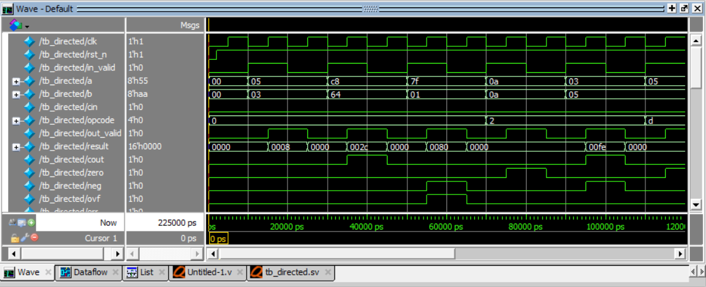

# RTL-Forge | 8-Bit ALU Design & Verification

<p align="center">
  
</p>

<p align="center">
  <b>Design it. Verify it. Prove it.</b>
</p>

<p align="center">
  
  
  
  
</p>

---

## Overview

**RTL-Forge** is a Digital IC Design and RTL Verification portfolio project featuring a custom 8-bit Arithmetic Logic Unit (ALU) implemented in SystemVerilog.

The project focuses on RTL architecture, combinational datapath design, sequential output registration, arithmetic flag generation, control decoding, and simulation-based functional verification.

A dedicated directed testbench applies predefined stimulus to the ALU and checks the observed outputs against expected results.

The repository documents both the design and the verification methodology, providing a foundation for further work in constrained-random verification, assertions, functional coverage, and UVM.

## Project Objectives

- Design an 8-bit ALU using synthesizable SystemVerilog constructs.
- Implement arithmetic, logical, shift, rotate, multiplication, and comparison operations.
- Generate status flags including carry/borrow, zero, negative, and signed overflow.
- Implement synchronous transaction capture with an active-low asynchronous reset.
- Develop a directed testbench with explicit expected outputs.
- Verify representative normal, boundary, and invalid-opcode scenarios.
- Document the RTL architecture, interface, operation encoding, and test strategy.

## Architecture

<p align="center">
  
</p>

The design is organized into two main functional sections.

### 1. Combinational Datapath

The `always_comb` block evaluates the selected operation and calculates the next output structure.

Its responsibilities include:

- Decoding the operation using the opcode enumeration.
- Performing arithmetic and logical computations.
- Calculating status flags.
- Handling multiplication and comparison.
- Detecting reserved or unsupported opcodes.
- Preparing the next output values.

The combinational output structure is named `out_n`.

### 2. Sequential Output Stage

The `always_ff` block captures the computed result on the rising edge of the clock.

- `out_valid` follows `in_valid` with one clock-edge sampling stage.
- When `in_valid` is high, `out_n` is captured into `out_q`.
- When `in_valid` is low, the registered output structure is cleared.
- When `rst_n` goes low, the output registers are cleared asynchronously.

The registered output structure is named `out_q`.

### 3. Datapath Flow

<p align="center">
  
</p>

The conceptual data flow is:

`Inputs → Opcode Decode → Operation Logic → Result and Flags → Output Register → Outputs`

The combinational logic calculates the next values, while the sequential stage controls when those values become visible at the module outputs.

## Supported Operations

The ALU accepts two 8-bit operands, a carry/borrow input, and a 4-bit opcode.

| Opcode | Operation | Description |
|:---:|---|---|
| `0x0` | ADD | Unsigned addition |
| `0x1` | ADDC | Addition with carry input |
| `0x2` | SUB | Subtraction |
| `0x3` | SUBB | Subtraction with borrow input |
| `0x4` | AND | Bitwise AND |
| `0x5` | OR | Bitwise OR |
| `0x6` | XOR | Bitwise XOR |
| `0x7` | NOT | Bitwise complement of operand A |
| `0x8` | SHL | Logical left shift |
| `0x9` | SHR | Logical right shift |
| `0xA` | ROL | Rotate left |
| `0xB` | ROR | Rotate right |
| `0xC` | MUL | 8-bit multiplication with 16-bit product |
| `0xD` | CMP | Comparison using subtraction flags |
| `0xE` | Reserved | Error indication |
| `0xF` | Reserved | Error indication |

**Shift and rotate behavior:** The shift amount is taken from `b[2:0]`, so the supported shift amounts range from 0 to 7.

**Important implementation detail:** `CMP` calculates subtraction-related flags while forcing the reported result to zero. Reserved opcodes generate an error indication and clear the remaining output fields.

Refer to the RTL source for the exact implementation semantics.

## Interface Specification

### Inputs

| Signal | Width | Description |
|---|---:|---|
| `clk` | 1 bit | Rising-edge clock |
| `rst_n` | 1 bit | Active-low asynchronous reset |
| `in_valid` | 1 bit | Indicates a valid input transaction |
| `a` | 8 bits | First operand |
| `b` | 8 bits | Second operand / shift amount |
| `cin` | 1 bit | Carry or borrow input for applicable operations |
| `opcode` | 4 bits | Operation selector |

### Outputs

| Signal | Width | Description |
|---|---:|---|
| `out_valid` | 1 bit | Indicates a valid sampled transaction |
| `result` | 16 bits | Operation result |
| `cout` | 1 bit | Carry or borrow indication, depending on operation |
| `zero` | 1 bit | Indicates a zero result according to operation-specific logic |
| `neg` | 1 bit | Sign bit of the 8-bit result for applicable operations |
| `ovf` | 1 bit | Signed arithmetic overflow indication |
| `err` | 1 bit | Indicates a reserved or unsupported opcode |

## Output and Flag Behavior

### Result Width

Most operations produce an 8-bit result that is zero-extended to 16 bits. Multiplication produces a full 16-bit product.

### Carry and Borrow

- Addition operations use the ninth bit of the extended sum as `cout`.
- Subtraction operations use the comparison `a9 < amt9` to indicate a borrow.
- Shift operations use the implementation-specific shifted-out bit.
- Operations that do not calculate carry or borrow leave `cout` at zero.

### Zero Flag

For most non-multiplication operations, `zero` is based on whether the calculated 8-bit result is zero. For multiplication, it checks the full 16-bit product.

### Negative Flag

For applicable non-multiplication operations, `neg` reflects bit 7 of the 8-bit result.

### Overflow Flag

The overflow logic detects signed overflow for addition and subtraction operations. The flag remains zero for operations that do not calculate arithmetic overflow.

### Error Flag

Reserved opcodes `0xE` and `0xF` set `err` to one and clear the other output fields.

## Verification Strategy


The testbench, `tb_directed.sv`, instantiates the ALU and applies directed test cases.

Each test case provides:

- A descriptive test name.
- Input operands.
- Carry/borrow input.
- Opcode.
- Expected result.
- Expected status flags and error indication.

The testbench compares the DUT outputs against the expected values using case equality (`===`), allowing unknown (`X`) or high-impedance (`Z`) values to cause a mismatch instead of being silently treated as a valid match.

A test passes only when `out_valid` is asserted and all checked outputs match the expected values.

The testbench maintains separate pass and fail counters and prints a final summary.

### Implemented Test Scenarios

| Test | Scenario | Purpose |
|---|---|---|
| 1 | `5 + 3` | Basic addition |
| 2 | `200 + 100` | Carry-out behavior |
| 3 | `0x7F + 0x01` | Signed overflow |
| 4 | `10 - 10` | Zero result |
| 5 | `3 - 5` | Borrow and negative result |
| 6 | `5 CMP 5` | Comparison flags |
| 7 | `0xF0 AND 0x0F` | Logical operation |
| 8 | `0x81 SHL 1` | Shift and shifted-out bit |
| 9 | `255 × 255` | Full-width multiplication |
| 10 | Reserved opcode `0xE` | Invalid-operation handling |
| 11 | Asynchronous reset during a transaction | Reset behavior |

The testbench currently includes directed tests for selected operations. It should not be interpreted as exhaustive verification of all opcodes, input combinations, and corner cases.

### Self-Checking Methodology

The testbench uses a reusable `check_case` task to reduce duplicated stimulus and checking code.

Conceptually, each transaction follows this sequence:

1. Wait for the falling clock edge.
2. Apply the operands and opcode.
3. Assert `in_valid`.
4. Allow the DUT to sample the transaction on the rising edge.
5. Deassert `in_valid` at the following falling edge.
6. Compare the registered outputs against the expected values.
7. Record and report the pass/fail result.

The asynchronous reset test additionally checks whether the outputs clear without waiting for another rising clock edge.

## Simulation Results

<p align="center">
  
</p>

The waveform image should be generated from an actual simulator run and should show representative input transactions, `in_valid`, `out_valid`, the result, status flags, and reset behavior.

**Verification status:** Simulation results have not yet been published in this repository. The expected test outcomes are specified in the testbench; actual PASS/FAIL results should be recorded after running the simulation.

### Example Testbench Output Format

```text
PASS: 1. ADD 5 + 3 = 8
PASS: 2. ADD 200 + 100
PASS: 3. ADD 7F + 01 overflow
...

==============================================
TEST SUMMARY
==============================================
PASS = <actual pass count>
FAIL = <actual fail count>
==============================================
OVERALL RESULT: <actual result>
```

The lines above illustrate the report format, not a verified simulation log.

## Repository Structure

```text
rtl-forge/
├── README.md
├── LICENSE
├── .gitignore
├── rtl/
│   └── alu.sv
├── tb/
│   └── tb_directed.sv
├── docs/
│   ├── architecture.md
│   ├── verification-plan.md
│   └── operation-specification.md
├── images/
│   ├── hero-banner.png
│   ├── alu-block-diagram.png
│   ├── datapath-flow.png
│   ├── verification-flow.png
│   └── simulation-waveform.png
└── results/
    └── test-summary.txt
```

Some documentation and image files are planned additions and may not exist in the initial version.

## Tools and Technologies

- **SystemVerilog:** RTL implementation and testbench development.
- **QuestaSim / ModelSim:** Suitable simulators for running the design and directed testbench.
- **Git and GitHub:** Source control and project documentation.

Only list tools actually used to compile, simulate, or inspect this project in the final portfolio.

## Running the Simulation

The following commands are intended for QuestaSim / ModelSim. Run them from the repository root.

### 1. Compile the RTL and Testbench

```tcl
vlib work
vlog -sv rtl/alu.sv tb/tb_directed.sv
```

### 2. Run the Testbench

```tcl
vsim -c work.tb_directed -do "run -all; quit"
```

To inspect waveforms interactively, use:

```tcl
vsim work.tb_directed
add wave -r sim:/tb_directed/*
run -all
```

If the simulator reports compilation errors, resolve them before interpreting any test output.

## Current Limitations and Future Improvements

The current implementation uses a directed testbench. Potential next steps include:

- Expand directed tests to cover every opcode.
- Add boundary-value and corner-case testing.
- Add randomized stimulus with a separate reference model.
- Add SystemVerilog Assertions (SVA) for interface and reset properties.
- Add functional coverage for opcodes, operand classes, and important flag combinations.
- Add mutation testing to demonstrate that the testbench detects intentional RTL faults.
- Automate compilation and regression execution.
- Document the exact behavior of every flag for every operation.
- Add a UVM-based verification environment as a future extension.

These are planned improvements, not features claimed to be implemented in the current version.

## Author

**Salah Eldeen Ahmed**

Digital IC Design & RTL Verification

Interested in RTL development, SystemVerilog, functional verification, and hardware design.

- GitHub: https://github.com/engSalah-dot
- LinkedIn: https://www.linkedin.com/in/salah-ebied-3138241b1

## License

This project can be published under the MIT License if you choose to permit reuse and modification. Add a `LICENSE` file containing the actual MIT License text before claiming that the repository is MIT-licensed.

---

<p align="center">
  <i>RTL-Forge — Building reliable hardware through disciplined design and verification.</i>
</p>
